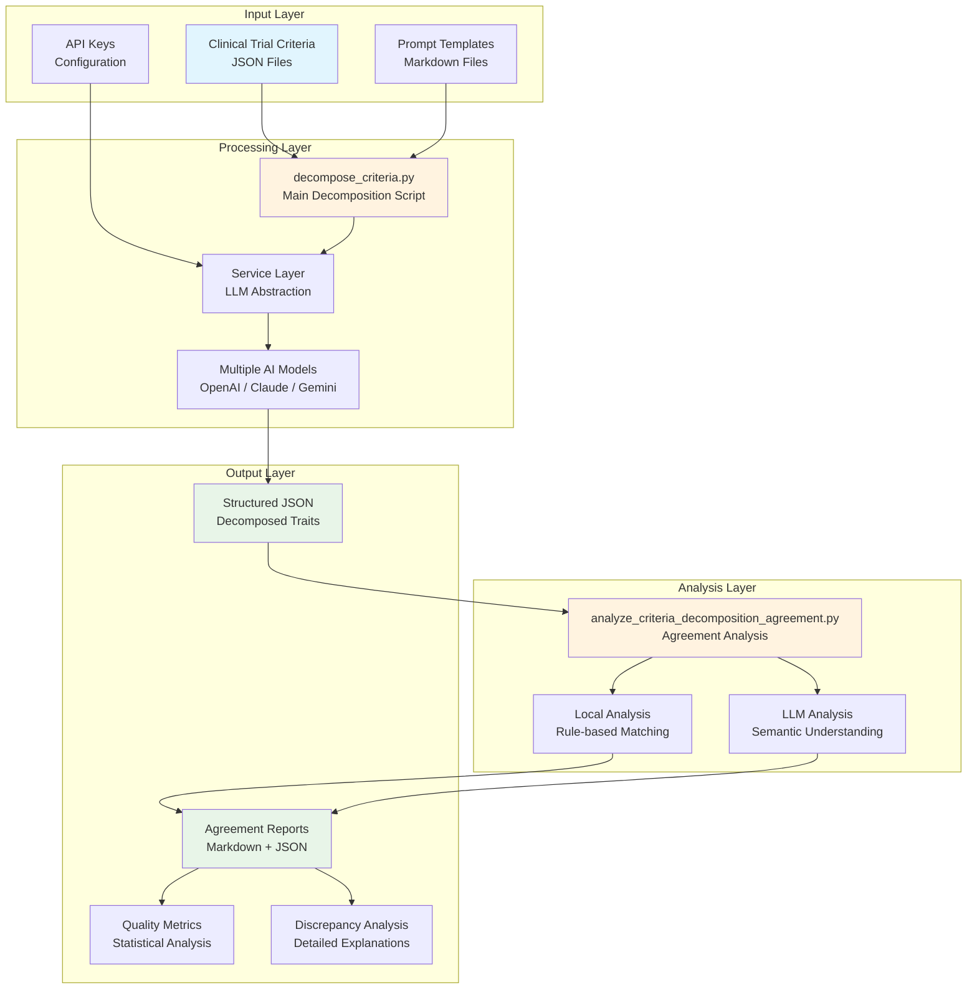
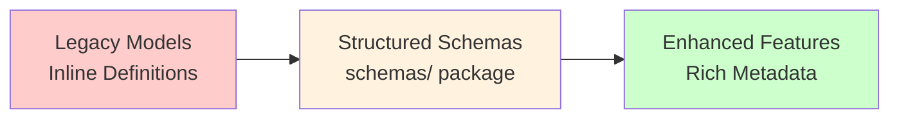
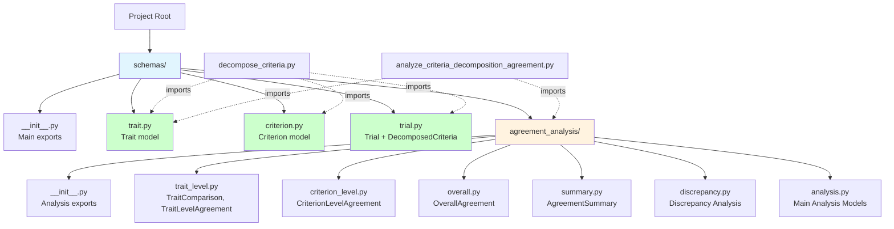
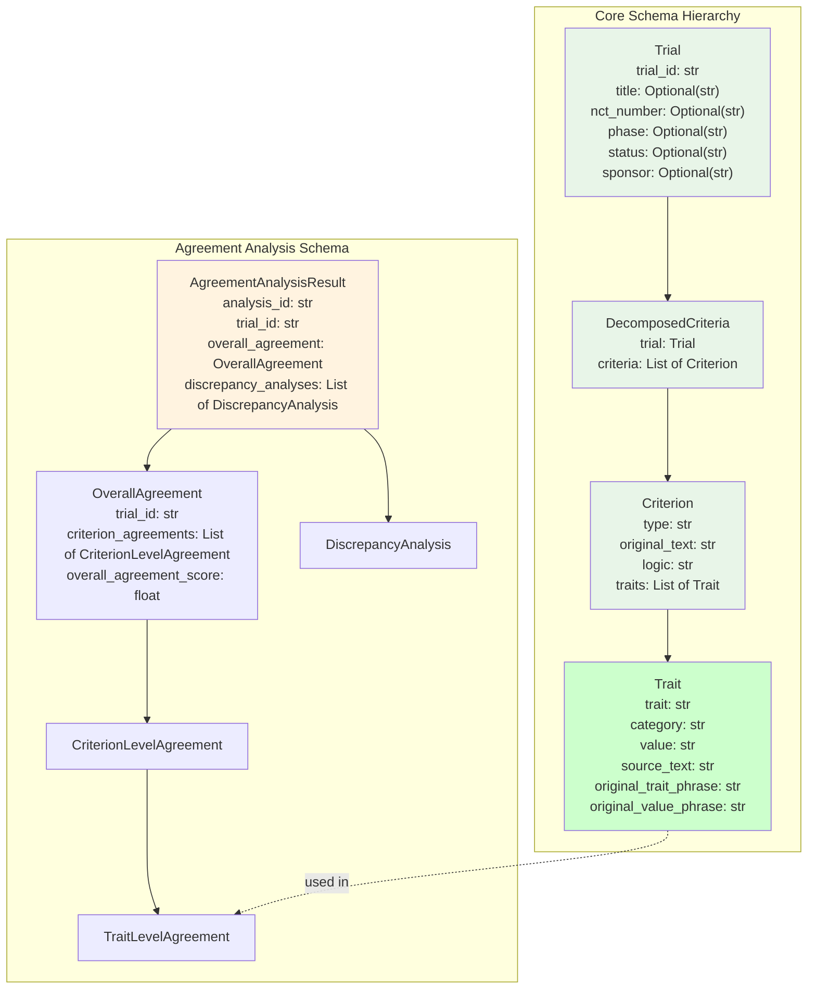

# Clinical Trial Criteria Analyzer


A comprehensive system for decomposing clinical trial eligibility criteria into structured traits and analyzing agreement between different reviewers (human or AI models). This tool enables automated extraction of clinical concepts from trial criteria and provides quality assessment through multi-reviewer comparison.

## 🎯 Overview

The Clinical Trial Criteria Analyzer transforms unstructured eligibility criteria text into structured, machine-readable traits that can be used for patient matching, trial optimization, and clinical research automation. The system supports multiple AI models and provides comprehensive agreement analysis to ensure decomposition quality.

### Key Features

- **🔍 Automated Trait Extraction**: Convert free-text eligibility criteria into structured traits
- **🤖 Multi-Model Support**: OpenAI GPT, Google Gemini, and Anthropic Claude integration
- **📊 Agreement Analysis**: Quantitative and qualitative assessment of decomposition consistency
- **⚡ Flexible Processing**: Single trial or batch processing capabilities
- **📈 Quality Metrics**: Precision, recall, F1-score, Cohen's kappa, and Jaccard index
- **🔧 Modular Architecture**: Service-based design for easy extension and maintenance
- **🔍 LangSmith Integration**: Advanced debugging and tracing for LLM operations

## 🏗️ System Architecture



## 🚀 Quick Start

### Prerequisites

- Python 3.10 or higher
- API keys for at least one LLM provider (OpenAI, Claude, or Gemini)
- Git (for cloning the repository)

### Installation

1. **Clone the repository**:
   ```bash
   git clone https://github.com/ynzhuang/Traits_analysis.git
   cd Traits_analysis
   ```

2. **Install dependencies**:
   ```bash
   pip install -r requirements.txt
   ```

3. **Configure API keys**:
   ```bash
   cp api_keys_template.json api_keys.json
   # Edit api_keys.json with your actual API keys
   ```

### Basic Usage

#### 1. Decompose Clinical Trial Criteria

```bash
python decompose_criteria.py \
  --prompt prompts/ici_trial_eligibility_criteria_decompose_prompt.md \
  --criteria sample_data/ici_criteria_sample.json \
  --api-keys api_keys.json \
  --model claude
```

#### 2. Analyze Agreement Between Models

```bash
python analyze_criteria_decomposition_agreement.py \
  --input-dir outputs/ici_criteria_sample/ \
  --output outputs/agreement_analysis.json \
  --local-only
```

#### 3. Run Complete Demo

```bash
python demo/demo_agreement_analysis.py \
  --api-keys api_keys.json \
  --model claude
```

## 📋 Core Workflows

### Workflow 1: Single Model Decomposition

For decomposing criteria with a single AI model:

```bash
# Step 1: Decompose criteria
python decompose_criteria.py \
  --prompt prompts/ici_trial_eligibility_criteria_decompose_prompt.md \
  --criteria sample_data/ici_criteria_sample.json \
  --api-keys api_keys.json \
  --model openai \
  --model-name gpt-4o

# Output: outputs/ici_criteria_sample/ici_criteria_sample-openai-gpt-4o-TIMESTAMP.json
```

### Workflow 2: Multi-Model Comparison

For comparing decomposition quality across different models:

```bash
# Step 1: Decompose with multiple models
for model in openai claude gemini; do
  python decompose_criteria.py \
    --prompt prompts/ici_trial_eligibility_criteria_decompose_prompt.md \
    --criteria sample_data/ici_criteria_sample.json \
    --api-keys api_keys.json \
    --model $model
done

# Step 2: Analyze agreement
python analyze_criteria_decomposition_agreement.py \
  --input-dir outputs/ici_criteria_sample/ \
  --output outputs/multi_model_agreement.json \
  --local-only
```

### Workflow 3: Batch Processing

For processing multiple trials simultaneously:

```bash
# Prepare multiple trial files in a directory
# Each file should contain trial criteria in the expected JSON format

python decompose_criteria.py \
  --prompt prompts/ici_trial_eligibility_criteria_decompose_prompt.md \
  --criteria data/multiple_trials.json \
  --api-keys api_keys.json \
  --model claude
```

### Workflow 4: Custom Analysis with LLM

For sophisticated agreement analysis using AI models:

```bash
python analyze_criteria_decomposition_agreement.py \
  --input-dir outputs/ici_criteria_sample/ \
  --output outputs/llm_agreement_analysis.json \
  --prompt prompts/study_traits_agreement_analysis_prompt.md \
  --api-keys api_keys.json \
  --model claude
```

## ⚙️ Configuration

### API Keys Setup

Create [`api_keys.json`](api_keys_template.json) with your credentials:

```json
{
  "openai": {
    "api-key": "sk-your-openai-key",
    "model": "gpt-4o"
  },
  "claude": {
    "api-key": "sk-ant-your-claude-key", 
    "model": "claude-sonnet-4-20250514"
  },
  "gemini": {
    "api-key": "your-gemini-key",
    "model": "gemini-2.5-pro"
  },
  "langsmith": {
    "api-key": "ls_your-langsmith-key",
    "project": "criteria-analyzer"
  }
}
```

### Model Selection Guide

| Provider | Model | Strengths | Best For |
|----------|-------|-----------|----------|
| **OpenAI** | `gpt-4o` | Fast, reliable, good structured output | General decomposition tasks |
| **Claude** | `claude-sonnet-4` | Excellent reasoning, detailed analysis | Complex criteria, nuanced extraction |
| **Gemini** | `gemini-2.5-pro` | Strong multilingual, cost-effective | Large-scale processing |

### Prompt Customization

Modify [`prompts/ici_trial_eligibility_criteria_decompose_prompt.md`](prompts/ici_trial_eligibility_criteria_decompose_prompt.md) to:
- Add new trait categories
- Adjust extraction granularity
- Include domain-specific instructions
- Modify output format requirements

### Schema Migration Benefits

The recent schema reorganization provides several key improvements:

#### ✅ **Enhanced Organization**
- **Granular Structure**: One model per file for clear responsibilities
- **Logical Grouping**: Agreement analysis models separated into dedicated package
- **Clear Dependencies**: Explicit import chains prevent circular dependencies

#### ✅ **Rich Data Models**
- **Enhanced Trial Representation**: Beyond simple trial IDs to full metadata
- **Consolidated Trait Model**: Merged `Trait` and `TraitInfo` into comprehensive model
- **Comprehensive Agreement Analysis**: 6 specialized models for different analysis levels

#### ✅ **Backward Compatibility**
- **Seamless Migration**: Existing scripts work without modification
- **Legacy Support**: Maintained compatibility with existing prompts
- **Gradual Adoption**: Can migrate to new models incrementally

#### 🔄 **Migration Path**



**Current State**: All models successfully migrated to structured schema package
**Next Steps**: Enhance prompts to leverage new agreement analysis capabilities

## 📊 Understanding Output

### Decomposed Criteria Structure

```json
{
  "NCT12345678": {
    "trial_id": "NCT12345678",
    "criteria": [
      {
        "type": "inclusion",
        "original_text": "Age 18 years or older",
        "logic": "(age >= 18)",
        "traits": [
          {
            "trait": "Age",
            "category": "Demographics", 
            "value": ">= 18 years"
          }
        ]
      }
    ]
  }
}
```

### Agreement Analysis Metrics

#### Quality Thresholds
- **🟢 Excellent**: F1-score > 0.9, Cohen's kappa > 0.8
- **🟡 Good**: F1-score > 0.8, Cohen's kappa > 0.6
- **🟠 Moderate**: F1-score > 0.6, Cohen's kappa > 0.4
- **🔴 Poor**: F1-score < 0.6, Cohen's kappa < 0.4

#### Metric Definitions
- **Precision**: Proportion of identified traits that are correct
- **Recall**: Proportion of actual traits that were identified
- **F1-Score**: Harmonic mean of precision and recall
- **Jaccard Index**: Intersection over union of trait sets
- **Cohen's Kappa**: Agreement corrected for chance

### Discrepancy Types

| Type | Description | Action |
|------|-------------|--------|
| `missing_in_reviewer_X` | Trait found by one reviewer but not another | Review extraction completeness |
| `category_mismatch` | Same trait, different categories | Standardize category definitions |
| `value_mismatch` | Same trait/category, different values | Normalize value formats |
| `granularity_mismatch` | Different levels of detail | Define extraction granularity |

## 🏗️ Schema Architecture

The system uses a comprehensive schema architecture with structured Pydantic models organized for maintainability and extensibility:

### Schema Organization



### Core Model Hierarchy



### Schema Benefits

- **🎯 Granular Organization**: One model per file for clear responsibilities
- **🔗 Rich Trial Representation**: Enhanced metadata beyond simple trial IDs
- **📦 Clear Dependencies**: Explicit imports prevent circular dependencies
- **🔧 Maintainability**: Isolated changes and single responsibility principle
- **🚀 Extensibility**: Easy to add new models and extend existing ones

### Usage Examples

```python
# Import core schemas
from schemas import Trait, Criterion, Trial, DecomposedCriteria

# Create rich trial metadata
trial = Trial(
    trial_id="NCT12345678",
    title="A Phase II Study of Drug X in Cancer Patients",
    phase="Phase II",
    status="Recruiting",
    sponsor="Example Pharmaceutical Company"
)

# Import agreement analysis schemas
from schemas.agreement_analysis import (
    AgreementAnalysisConfig,
    AgreementAnalysisResult,
    DiscrepancyType
)
```

## 🏗️ Project Structure

```
criteria-analyzer/
├── README.md                          # This file
├── requirements.txt                   # Python dependencies
├── api_keys_template.json            # API keys template
├──
├── decompose_criteria.py             # Main decomposition script
├── analyze_criteria_decomposition_agreement.py  # Agreement analysis
├──
├── schemas/                          # 🆕 Structured schema package
│   ├── __init__.py                  # Main schema exports
│   ├── trait.py                     # Trait model (consolidated)
│   ├── criterion.py                 # Criterion model
│   ├── trial.py                     # Trial and DecomposedCriteria models
│   └── agreement_analysis/          # Agreement analysis schemas
│       ├── __init__.py             # Analysis exports
│       ├── trait_level.py          # Trait-level agreement models
│       ├── criterion_level.py      # Criterion-level agreement models
│       ├── overall.py              # Overall agreement models
│       ├── summary.py              # Summary analysis models
│       ├── discrepancy.py          # Discrepancy analysis models
│       └── analysis.py             # Main analysis orchestration models
├──
├── docs/                            # Documentation hub
│   ├── README.md                    # Documentation index
│   ├── setup/                       # Setup guides
│   │   └── LANGSMITH_SETUP.md      # LangSmith configuration
│   └── services/                    # Service layer docs
│       └── README.md               # Service architecture guide
├──
├── services/                         # Service layer (LLM abstraction)
│   ├── __init__.py
│   ├── api_key_service.py           # API key management
│   ├── llm_service.py               # LLM factory and configuration
│   ├── prompt_service.py            # Prompt template processing
│   ├── cache_service.py             # Response caching
│   └── chain_service.py             # Chain execution and retry logic
├──
├── prompts/                         # Prompt templates
│   ├── ici_trial_eligibility_criteria_decompose_prompt.md
│   └── study_traits_agreement_analysis_prompt.md
├──
├── sample_data/                     # Example data
│   ├── ici_criteria_sample.json    # Sample trial criteria
│   └── decomposed/                  # Sample decomposed outputs
├──
├── outputs/                         # Generated results
├── demo/                           # Demonstration scripts
│   ├── demo_agreement_analysis.py  # Main demo script
│   ├── langsmith_demo.py           # LangSmith demo
│   ├── DEMO_agreement_analysis_README.md  # Demo documentation
│   └── DEMO_agreement_analysis_SUMMARY.md # Demo summary
├── tests/                          # Test suite
├── ref/                            # Reference materials
│   └── api_analysis.md             # API integration plan
└── report_templates/               # Report generation templates
    └── agreement_analysis_n_reviewer_report.md
```

## 🔧 Advanced Features

### Service Layer Architecture

The system uses a modular service layer that abstracts LLM operations:

- **[`APIKeyService`](services/api_key_service.py)**: Secure API key management
- **[`LLMService`](services/llm_service.py)**: Multi-provider LLM factory
- **[`PromptService`](services/prompt_service.py)**: Template processing and formatting
- **[`CacheService`](services/cache_service.py)**: Response caching for efficiency
- **[`ChainService`](services/chain_service.py)**: Execution with retry logic

See [`docs/services/README.md`](docs/services/README.md) for detailed service documentation.

### Performance Optimization

#### Caching
```bash
# Enable caching (default)
python decompose_criteria.py --cache [other options]

# Disable caching
python decompose_criteria.py --no-cache [other options]
```

#### Batch Processing
```bash
# Process multiple trials in one file
python decompose_criteria.py \
  --criteria data/batch_trials.json \
  --api-keys api_keys.json \
  --model claude
```

### Custom Model Integration

To add a new LLM provider, modify [`services/llm_service.py`](services/llm_service.py):

```python
def get_llm(provider: str, api_keys: Dict, output_schema: BaseModel):
    if provider == "your_provider":
        return YourProviderLLM(
            api_key=api_keys["your_provider"]["api-key"],
            model=api_keys["your_provider"]["model"]
        ).with_structured_output(output_schema)
```

## 🧪 Testing and Validation

### Running Tests

```bash
# Run all tests — 25 tests, no API keys required
pytest tests/ -q

# Or via the project's runner
python tests/run_tests.py

# Run a specific module
python -m pytest tests/test_decompose_criteria.py -v
```

The suite is hermetic: it mocks `ChainService`/`LLMService` and contacts no
model provider, so it runs offline and costs nothing.

### Continuous integration

[`.github/workflows/ci.yml`](.github/workflows/ci.yml) runs on every push and
pull request:

| Job | What it covers |
|---|---|
| **Python 3.10 / 3.11 / 3.12** | installs from `requirements.txt`, imports every top-level module, runs the 25 tests |
| **Web UI backend** | boots the Flask app and exercises all 7 routes against the committed sample data |
| **Web UI frontend** | `npm ci`, `next lint`, `next build` (type-checks as part of the build) |

The import check in the Python job is deliberate. Dependency drift here does
not surface as a failing test — it surfaces as a module that will not import,
which is exactly how the unpinned-LangChain breakage described in
[`CONTRIBUTING.md`](CONTRIBUTING.md) went unnoticed.

### Validation Methods

1. **Sample Data Testing**: Use provided sample data to verify functionality
2. **Cross-Model Validation**: Compare outputs across different models
3. **Manual Review**: Expert validation of complex criteria
4. **Automated Checks**: Schema validation and completeness checks

### Quality Assurance

```bash
# Run demo with quality checks
python demo/demo_agreement_analysis.py \
  --api-keys api_keys.json \
  --model claude

# Validate decomposition quality
python analyze_criteria_decomposition_agreement.py \
  --input-dir outputs/your_data/ \
  --output outputs/quality_report.json \
  --local-only
```

## 🔍 Troubleshooting

### Common Issues

#### API Key Problems
```bash
# Error: Authentication failed
# Solution: Verify API keys in api_keys.json
cat api_keys.json  # Check format and keys
```

#### Memory Issues
```bash
# Error: Out of memory
# Solution: Use local analysis for large datasets
python analyze_criteria_decomposition_agreement.py \
  --input-dir large_dataset/ \
  --output results.json \
  --local-only
```

#### File Format Issues
```bash
# Error: JSON parsing failed
# Solution: Validate input file format
python -m json.tool sample_data/ici_criteria_sample.json
```

### Performance Tips

1. **Use Caching**: Keep default caching enabled for repeated runs
2. **Local Analysis**: Use `--local-only` for large-scale agreement analysis
3. **Batch Processing**: Process multiple trials together when possible
4. **Model Selection**: Choose appropriate models based on speed vs. quality needs

## 📚 Documentation

### Component Documentation
- **[Documentation Hub](docs/README.md)**: Complete documentation index
- **[Service Layer](docs/services/README.md)**: Service architecture and API reference
- **[LangSmith Setup](docs/setup/LANGSMITH_SETUP.md)**: Debugging and tracing configuration guide
- **[CONTRIBUTING.md](CONTRIBUTING.md)**: setup, the dependency pins, and the schema contract
- **[SECURITY.md](SECURITY.md)**: what reaches model providers, API-key handling, caching and cost
- **[Demo Guide](demo/DEMO_agreement_analysis_README.md)**: Comprehensive demo documentation

### API Reference
- **[`decompose_criteria.py`](decompose_criteria.py)**: Main decomposition script
- **[`analyze_criteria_decomposition_agreement.py`](analyze_criteria_decomposition_agreement.py)**: Agreement analysis script
- **[Demo Scripts](demo/)**: Example usage and demonstrations
- **[API Integration](ref/api_analysis.md)**: ClinicalTrials.gov API usage plan

## 🤝 Integration and Extension

### Downstream Applications

The structured output can be used for:
- **Patient Matching**: Automated eligibility screening
- **Trial Optimization**: Criteria refinement and standardization
- **Research Analytics**: Large-scale trial analysis
- **Regulatory Compliance**: Standardized criteria documentation

### API Integration

```python
# Example: Using decomposed criteria in your application
import json

with open('outputs/decomposed_criteria.json', 'r') as f:
    criteria = json.load(f)

for trial_id, trial_data in criteria.items():
    for criterion in trial_data['criteria']:
        for trait in criterion['traits']:
            # Process trait for patient matching
            process_trait(trait['trait'], trait['category'], trait['value'])
```

### Custom Extensions

1. **New Analysis Types**: Add custom agreement metrics
2. **Additional Outputs**: Generate different report formats
3. **Integration Hooks**: Connect to external systems
4. **Custom Prompts**: Domain-specific extraction rules

## 📈 Performance Benchmarks

### Sample Data Results
- **Processing Time**: ~30 seconds per trial (Claude)
- **Agreement Scores**: F1 0.7-0.9 between models
- **Memory Usage**: <2GB for typical datasets
- **API Costs**: ~$0.10-0.50 per trial depending on model

### Scalability
- **Single Trial**: Real-time processing
- **Batch (10 trials)**: 5-10 minutes
- **Large Scale (100+ trials)**: Use batch processing and local analysis

## 🆘 Support and Contributing

### Getting Help
1. Check this README and component documentation
2. Review sample data and demo scripts
3. Examine log files for detailed error information
4. Validate input data format and API keys

### Best Practices
- **Start Small**: Test with sample data before large datasets
- **Validate Early**: Check decomposition quality with agreement analysis
- **Monitor Costs**: Track API usage for large-scale processing
- **Version Control**: Keep track of prompt and configuration changes

## ⚠️ Known gaps

Recorded honestly rather than left to be discovered.

**The agreement schema was refactored and two consumers were left behind.**
`schemas/agreement_analysis.py` now emits `AgreementAnalysisResult` —
`analysis_metadata`, `agreement_summary.overall`, `trials[]`,
`quality_metrics`, `semantic_normalization_log`. An earlier shape
(`AgreementAnalysis` with `trait_level`, `TraitLevelAgreement`,
`PairwiseMetrics`, `TraitInfo`, …) is gone. Two things still expect the old
one:

- *The tests.* Seven cases in
  `tests/test_analyze_criteria_decomposition_agreement.py` constructed the
  removed models or called the removed `analyze_agreement_local()`. They have
  been deleted rather than rewritten — the code they covered no longer
  exists. The surviving eight cover the functions that do.
- *The web UI.* Its components read `agreement_summary.trait_level[]` and
  per-trait `fleiss_kappa`, **which the current analysis does not produce**.
  The comparison table therefore renders reviewer extractions correctly and
  shows `N/A` in the Agreement column. It reports the absence rather than
  displaying a fabricated coefficient — an invented kappa in an
  inter-rater-agreement tool would be worse than a blank.

Closing this means deciding which shape is canonical, then updating the other
side. It is a design decision, not a cleanup, which is why it is documented
rather than patched over.

**Kappa is computed but not surfaced end to end.**
`calculate_fleiss_kappa()` and `calculate_fleiss_kappa_for_traits()` exist and
are covered by `tests/test_fleiss_kappa.py`, but the serialized analysis
output carries no per-trait coefficient for the UI to display.

**`reviewer_extractions` is `null`** throughout the committed sample analysis,
so per-reviewer provenance is not available to consumers of that file.

**The web UI ships no tests.** CI builds, lints, and type-checks it, and
smoke-tests the backend's routes, but no component is asserted on.

## 📄 License

[MIT](LICENSE).

The criteria under `sample_data/` and `ref/` derive from ClinicalTrials.gov,
a public registry of trial protocols. They describe eligibility rules, not
people — there is no patient data in this repository. See
[`SECURITY.md`](SECURITY.md).

## 🙏 Acknowledgments

This system leverages:
- **LangChain**: LLM orchestration and chaining
- **OpenAI, Anthropic, Google**: AI model providers
- **Pydantic**: Data validation and serialization
- **Python Ecosystem**: Core libraries and tools

---

**Quick Links:**
- [🚀 Quick Start](#-quick-start)
- [📋 Core Workflows](#-core-workflows)
- [📊 Understanding Output](#-understanding-output)
- [🔧 Advanced Features](#-advanced-features)
- [🧪 Testing and Validation](#-testing-and-validation)
- [📚 Documentation](#-documentation)