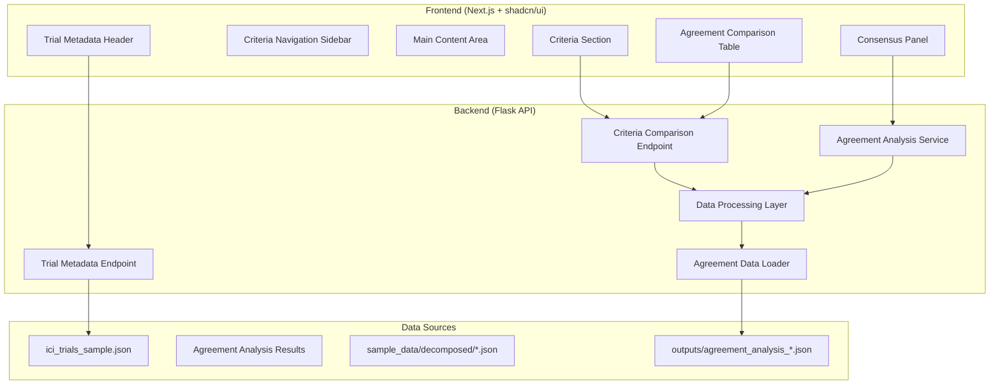

# Clinical Trial Criteria Comparison Web UI - Implementation Plan

## 📋 Project Overview

**Objective**: Create a full-stack web application to compare AI reviewer decompositions of clinical trial eligibility criteria with consensus analysis based on existing agreement analysis results.

**Tech Stack**: 
- **Backend**: Flask API (`webui/backend/`)
- **Frontend**: Next.js with shadcn/ui (`webui/frontend/`)
- **Data Sources**: 
  - Trial metadata: `sample_data/ici_trials_sample.json`
  - Reviewer decompositions: `sample_data/decomposed/*.json`
  - **Agreement analysis results**: `outputs/agreement_analysis_*.json` (from `analyze_criteria_decomposition_agreement.py`)

**Key Features**: 
- **Dynamic Reviewer Support** - Automatically detects and supports any number of reviewers
- **Pre-computed Consensus** - Uses existing trait-level agreement analysis with Fleiss' kappa scores
- **Trait Signature-based Consensus** - Leverages `trait_signature` format: `trait|category|value`

## 🏗️ System Architecture



## 🎯 Core Features & Components

### 1. **Agreement Analysis Integration System**
- **File Scanner**: Automatically detect agreement analysis results in `outputs/` directory
- **Reviewer Discovery**: Extract reviewer information from agreement analysis metadata
- **Pre-computed Consensus**: Use existing trait-level agreement results with Fleiss' kappa scores
- **Trait Signature Processing**: Parse `trait_signature` format (`trait|category|value`) for consensus display

### 2. **Data Integration Engine**
- **Multi-source Data Loading**: Combine trial metadata, reviewer decompositions, and agreement analysis
- **Trait Signature Mapping**: Map individual reviewer traits to consensus trait signatures
- **Agreement Metrics Display**: Show Fleiss' kappa scores and reviewer agreement counts
- **Discrepancy Highlighting**: Display identified discrepancies from agreement analysis

### 3. **Backend API Structure**
```
/api/
├── reviewers                           # Get list of available reviewers
├── trials/{trial_id}                   # Trial metadata
├── criteria/{trial_id}                 # All criteria for a trial
├── comparison/{trial_id}/{criterion_id} # Detailed comparison with agreement metrics
├── consensus/{trial_id}/{criterion_id}  # Pre-computed consensus from agreement analysis
└── agreement/{trial_id}                # Full agreement analysis results
```

### 4. **Frontend UI Layout (Agreement-Enhanced)**
```
┌─────────────────────────────────────────────────────────────┐
│                    Trial Metadata Header                    │
├─────────────────────────────────────────────────────────────┤
│ Nav │                 Main Content Area                     │
│ Bar │ ┌─────────────────────────────────────────────────────┤
│     │ │ Criterion 1: Original Text + Logic                 │
│ C1  │ ├─────────────────┬───────────────────────────────────┤
│ C2  │ │ Agreement       │     Consensus Traits              │
│ C3  │ │ Comparison      │     (Fleiss' κ + Agreement %)    │
│ ... │ │ Table           │                                   │
│     │ │ (N Reviewers)   │                                   │
│     │ │                 │                                   │
│     │ └─────────────────┴───────────────────────────────────┤
│     │ │ Criterion 2: Original Text + Logic                 │
│     │ └─────────────────────────────────────────────────────┤
└─────┴─────────────────────────────────────────────────────────┘
```

## 📊 Agreement Analysis Integration & Processing

### **Agreement Analysis Integration**
```python
def load_agreement_analysis(outputs_folder):
    """Load pre-computed agreement analysis results"""
    agreement_files = glob.glob(f"{outputs_folder}/agreement_analysis_*.json")
    latest_analysis = max(agreement_files, key=os.path.getctime)
    
    with open(latest_analysis, 'r') as f:
        analysis = json.load(f)
    
    return {
        'trait_level_agreement': analysis['agreement_summary']['trait_level'],
        'criterion_level_agreement': analysis['agreement_summary']['criterion_level'],
        'discrepancies': analysis['discrepancies'],
        'overall_stats': analysis['agreement_summary']['overall']
    }
```

### **Trait Signature-based Consensus**
```python
def get_consensus_traits(criterion_text, agreement_data):
    """Get consensus traits for a criterion from agreement analysis"""
    consensus_traits = []
    
    for trait_data in agreement_data['trait_level_agreement']:
        trait_signature = trait_data['trait_signature']
        trait_name, category, value = trait_signature.split('|')
        
        if trait_data['reviewer_agreement_count'] >= 2:  # Majority agreement
            consensus_traits.append({
                'trait': trait_name,
                'category': category,
                'value': value,
                'fleiss_kappa': trait_data['fleiss_kappa'],
                'agreement_count': trait_data['reviewer_agreement_count'],
                'total_reviewers': trait_data['total_possible_instances'],
                'confidence': trait_data['reviewer_agreement_count'] / trait_data['total_possible_instances']
            })
    
    return consensus_traits
```

### **Agreement-Enhanced Table Structure**
The comparison table shows reviewer decompositions with agreement metrics:
- **Individual Reviewer Columns**: Show each reviewer's trait extraction
- **Agreement Indicators**: Display Fleiss' kappa scores and agreement percentages
- **Consensus Column**: Highlight traits with majority agreement (2+ reviewers)
- **Discrepancy Highlighting**: Mark traits with disagreements or missing extractions

## 🛠️ Implementation Phases

### **Phase 1: Agreement Analysis Integration Backend**
1. **Flask API Setup with Agreement Integration**
   - Project structure creation
   - Agreement analysis data loader
   - Environment configuration

2. **Multi-source Data Loading**
   - Trial metadata loader (`sample_data/ici_trials_sample.json`)
   - Reviewer decomposition loader (`sample_data/decomposed/*.json`)
   - Agreement analysis loader (`outputs/agreement_analysis_*.json`)

3. **Core API Endpoints**
   - Reviewer list endpoint (from agreement analysis)
   - Trial metadata endpoint
   - Agreement-enhanced criteria listing

### **Phase 2: Consensus Display Engine**
1. **Trait Signature Processing System**
   - Parse trait signatures (`trait|category|value`)
   - Map reviewer traits to consensus signatures
   - Display agreement metrics (Fleiss' kappa, agreement counts)

2. **Advanced API Endpoints**
   - Comparison endpoint with agreement metrics
   - Pre-computed consensus results endpoint
   - Discrepancy analysis endpoint

### **Phase 3: Responsive Frontend Foundation**
1. **Next.js Project Setup**
   - shadcn/ui component library integration
   - Agreement-aware table component system
   - API client with agreement data support

2. **Core UI Components**
   - Trial metadata header
   - Criteria navigation sidebar
   - Responsive layout for agreement metrics

### **Phase 4: Agreement-Enhanced UI Implementation**
1. **Agreement-Aware Comparison Table Component**
   - Dynamic column generation based on available reviewers
   - Agreement metric display (Fleiss' kappa scores)
   - Discrepancy highlighting and tooltips

2. **Consensus Panel with Statistical Metrics**
   - Pre-computed consensus trait display
   - Agreement confidence indicators
   - Fleiss' kappa interpretation (poor/fair/moderate/substantial/perfect)

### **Phase 5: Integration & Enhancement**
1. **Full Agreement Analysis Integration**
   - Frontend-backend connectivity with agreement metrics
   - Real-time discrepancy highlighting
   - Performance optimization for large datasets

2. **Advanced Features**
   - Interactive agreement metric tooltips
   - Discrepancy explanation display
   - Export functionality for consensus results

## 📁 Project Structure

```
webui/
├── backend/
│   ├── app.py                 # Flask application
│   ├── routes/
│   │   ├── reviewers.py      # Reviewer info from agreement analysis
│   │   ├── trials.py         # Trial metadata routes
│   │   ├── criteria.py       # Criteria with agreement metrics
│   │   ├── consensus.py      # Pre-computed consensus display
│   │   └── agreement.py      # Agreement analysis endpoints
│   ├── services/
│   │   ├── agreement_loader.py # Load agreement analysis results
│   │   ├── data_loader.py    # Multi-source JSON data loading
│   │   ├── trait_mapper.py   # Map traits to signatures
│   │   └── consensus_processor.py # Process consensus from agreement data
│   ├── models/
│   │   └── schemas.py        # Flexible data models
│   └── requirements.txt
└── frontend/
    ├── package.json
    ├── next.config.js
    ├── tailwind.config.js
    ├── components/
    │   ├── ui/               # shadcn/ui components
    │   ├── TrialHeader.tsx   # Trial metadata display
    │   ├── CriteriaNav.tsx   # Navigation sidebar
    │   ├── AgreementComparisonTable.tsx # Reviewer comparison with metrics
    │   └── ConsensusPanel.tsx  # Pre-computed consensus display
    ├── pages/
    │   ├── api/              # Next.js API routes (proxy)
    │   └── index.tsx         # Main application page
    └── lib/
        ├── api.ts            # API client with agreement support
        └── utils.ts          # Utility functions
```

## 🎨 Agreement-Enhanced UI Component Specifications

### **Agreement-Enhanced Comparison Table Structure**
| Trait Signature | OpenAI | Claude | Gemini | κ | Agreement |
|------------------|--------|--------|--------|---|-----------|
| Diagnosis\|Diagnosis/Disease\|NSCLC | ✓ NSCLC | ✓ NSCLC | ✓ NSCLC | 1.0 | 3/3 (100%) |
| EGFR mutation\|Biomarkers/Molecular\|negative | ✓ Negative | ✓ Negative | ✓ negative | 1.0 | 3/3 (100%) |
| Life expectancy\|Other\|>=8 weeks | ✗ | ✓ >=8 weeks | ✓ >=8 weeks | 0.67 | 2/3 (67%) |

**Legend:**
- **κ**: Fleiss' kappa score (0.0-1.0)
- **✓**: Trait present in reviewer's extraction
- **✗**: Trait missing from reviewer's extraction

### **Consensus Panel with Agreement Metrics**
```
Consensus Results (Trait Signatures with 2+ Reviewer Agreement)

Perfect Agreement (κ = 1.0):
✓ Diagnosis|Diagnosis/Disease|NSCLC (3/3 reviewers)
✓ Stage|Diagnosis/Disease|IIIB or IV (3/3 reviewers)
✓ EGFR mutation|Biomarkers/Molecular|negative (3/3 reviewers)

Substantial Agreement (κ = 0.67):
⚠ Life expectancy|Other|>=8 weeks (2/3 reviewers)
  Missing in: claude-claude (categorized as Demographics)

Discrepancies Identified: 6 traits with reviewer disagreements
```

## 🔧 Technical Considerations

### **Agreement Analysis Integration Benefits**
- **Pre-computed Results**: No need for real-time trait alignment calculations
- **Statistical Rigor**: Leverages Fleiss' kappa for robust agreement measurement
- **Discrepancy Insights**: Built-in explanation of reviewer disagreements
- **Research Validation**: Uses established agreement analysis methodology

### **Performance Optimization**
- **Cached Agreement Data**: Pre-computed results eliminate processing overhead
- **Efficient Data Loading**: Direct mapping from agreement analysis to UI
- **Scalable Architecture**: Handles any number of reviewers from agreement analysis

### **Error Handling**
- **Missing Agreement Data**: Graceful fallback to basic comparison mode
- **Inconsistent Signatures**: Robust parsing of trait signature format
- **Data Validation**: Comprehensive validation of agreement analysis structure

### **Research Integration**
- **Methodology Alignment**: Follows established clinical trial criteria analysis practices
- **Reproducible Results**: Based on documented agreement analysis prompt
- **Extensible Framework**: Easy integration of new agreement analysis outputs

## 🚀 Key Advantages of Agreement Analysis Integration

1. **Scientific Rigor**: Uses established Fleiss' kappa methodology for agreement measurement
2. **Pre-computed Efficiency**: Eliminates need for real-time trait alignment calculations
3. **Comprehensive Insights**: Provides both consensus results and detailed discrepancy analysis
4. **Research Continuity**: Builds directly on existing analysis infrastructure
5. **Validated Methodology**: Leverages proven clinical trial criteria decomposition approach

This agreement analysis integration ensures the web UI provides scientifically rigorous consensus results while maintaining optimal performance and user experience.